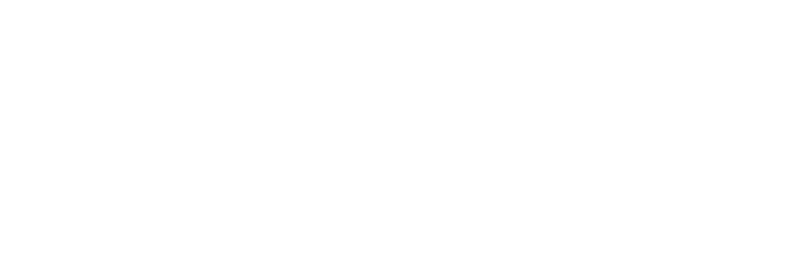
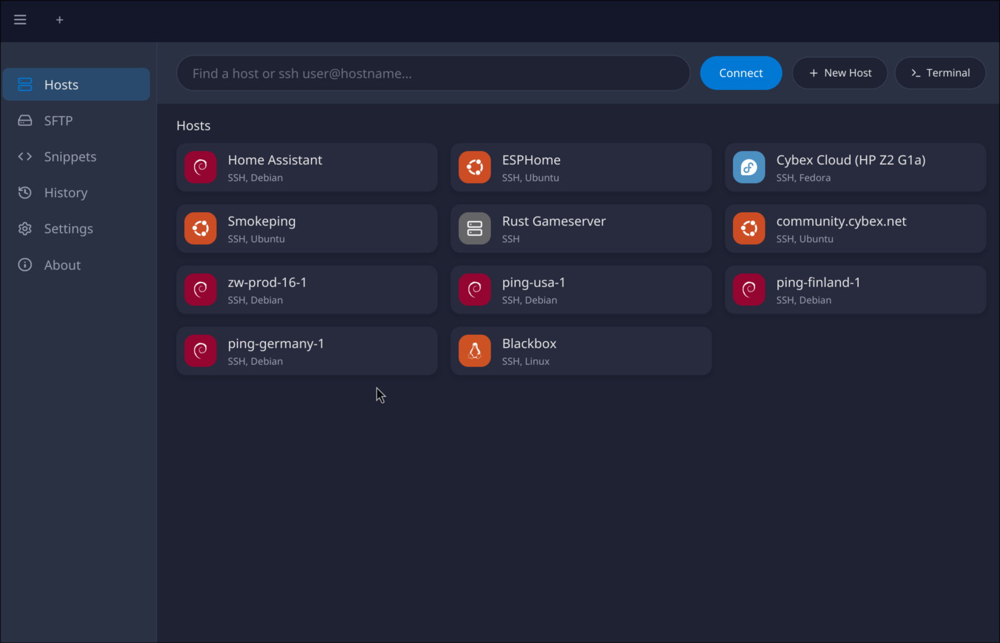
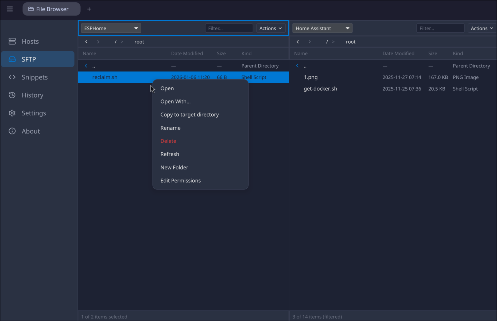

<div align="center">



# Portal

**A modern, fast SSH and VNC client for Linux**

[](LICENSE)
[](https://www.rust-lang.org/)
[](https://github.com/DigitalPals/portal/releases)
[](https://github.com/DigitalPals/portal/releases)
[](https://github.com/DigitalPals/portal/releases)
[](https://github.com/DigitalPals/portal/releases)



</div>

---

Portal is a native SSH and VNC client built for speed and simplicity. Manage your servers with an intuitive interface that's equally comfortable with keyboard shortcuts or mouse navigation. Built with Rust for native performance, with full Wayland support on Linux.

## Highlights

**`>_` Multi-Tab Terminal** — Manage multiple SSH sessions in tabs. Switch between servers instantly without juggling windows.

**`<>` Portal Hub Beta** — Keep SSH terminal sessions alive through a Tailscale-only hub, sync hosts/settings/snippets, and store encrypted private-key vault items.

**`< >` Dual-Pane SFTP** — Browse local and remote files side by side. Drag, drop, copy, and manage files with ease.

**`{ }` Smart OS Detection** — Automatically detects 20+ operating systems and displays branded icons for Ubuntu, Debian, Arch, Fedora, and more.

**`#!` Built-in File Viewer** — View code with syntax highlighting, preview images and PDFs, edit markdown—all without leaving Portal.

**`::` Beautiful Themes** — Choose from 6 built-in themes including the popular Catppuccin palette in both light and dark variants.

**`/>` Command Snippets** — Save frequently used commands and insert them into any session with a click. Never retype complex commands.

**`[]` VNC Remote Desktop** — Connect to VNC servers with GPU-accelerated rendering. Supports multiple encodings, ARD authentication, and multi-monitor displays.

## Features

### Terminal

- **Multi-tab sessions** — Open multiple SSH connections in tabs
- **Local terminal** — Launch local shell sessions alongside remote connections
- **Scrollback search** — Find text in the terminal buffer with `Ctrl+Shift+F`
- **Clickable links** — `Ctrl+click` URLs and file paths in terminal output; files open in the built-in viewer at the referenced line
- **Port forwarding** — Local, remote, and dynamic (SOCKS5) forwards per host
- **Jump hosts** — Chain connections through bastion hosts (ProxyJump)
- **Auto-reconnect** — Reconnects dropped sessions with exponential backoff
- **Session logging** — Optionally log terminal output to disk, plain or timestamped
- **Adjustable font size** — Scale from 6px to 20px for your preference
- **Configurable scroll speed** — Tune mouse wheel and trackpad scrollback speed
- **SSH key installation** — Install your public key on remote servers with `Ctrl+Shift+K`
- **Image clipboard paste** — Paste a screenshot into an SSH terminal to upload it and insert the remote image path
- **Status bar** — See hostname and connection duration at a glance
- **Session history** — Quick reconnect to recent servers
- **Portal Hub beta** — Route selected SSH hosts through Portal Hub for persistent remote terminal sessions, resumable thumbnails, reconnect replay, profile sync, and encrypted key vault storage

### SFTP File Browser

- **Dual-pane interface** — Local filesystem on one side, remote on the other
- **File operations** — Copy, rename, delete, and change permissions
- **Hidden files toggle** — Show or hide dotfiles with one click
- **Quick filter** — Search files in the current directory
- **Breadcrumb navigation** — Click any part of the path to jump there
- **Context menus** — Right-click for common actions

### Host Management

- **Host groups** — Organize servers into folders
- **SSH config import** — Import hosts (including ProxyJump chains) from `~/.ssh/config`
- **Quick connect** — Type `user@hostname` to connect instantly
- **Search & filter** — Find hosts as you type
- **Connection history** — See when you last connected and for how long
- **OS detection** — Automatic identification with branded icons for:
  - Ubuntu, Debian, Fedora, Arch, CentOS, RHEL
  - openSUSE, NixOS, Manjaro, Linux Mint, Pop!_OS
  - Gentoo, Alpine, Kali, Rocky, AlmaLinux
  - macOS, FreeBSD, OpenBSD, NetBSD, Windows

### File Viewer

- **Syntax highlighting** — Support for 20+ languages including Rust, Python, JavaScript, Go, and more
- **Image viewer** — View PNG, JPG, GIF, WebP, SVG with zoom controls
- **PDF viewer** — Read PDF documents with page navigation
- **Markdown preview** — Toggle between edit and rendered preview
- **In-app editing** — Make quick edits without leaving Portal

### VNC Remote Desktop

- **GPU-accelerated rendering** — Custom wgpu shader for efficient framebuffer display
- **Multiple encodings** — Tight, ZRLE, CopyRect, and Raw with automatic selection
- **ARD authentication** — Apple Remote Desktop support for macOS Screen Sharing
- **SSH tunneling** — Carry VNC traffic over an encrypted SSH channel; the toolbar warns when a session runs unencrypted
- **Scaling modes** — Fit, Actual (1:1), and Stretch modes
- **Keyboard passthrough** — Forward all keystrokes to the remote desktop
- **Special key toolbar** — Send Ctrl+Alt+Del, Alt+Tab, Super, Print Screen, and more
- **Clipboard sharing** — Bidirectional clipboard between local and remote
- **Screenshot capture** — Save the current VNC view to a file
- **Adaptive quality** — FPS tracking with configurable refresh rate, encoding, and color depth

### Customization

- **6 built-in themes**
  - Portal Default
  - Catppuccin Latte (light)
  - Catppuccin Frappé (dark)
  - Catppuccin Macchiato (dark)
  - Catppuccin Mocha (dark)
  - Noctalia (dark)
- **Responsive layout** — Sidebar auto-collapses on narrow windows
- **Keyboard-first** — Full keyboard navigation support



## Installation

### Download

Download from the Releases page:
https://github.com/DigitalPals/portal/releases

Pick the file that matches your OS and CPU:

| Platform | Asset name |
|----------|------------|
| Linux (arm64) | `portal-*-linux-arm64.deb` / `.rpm` / `.tar.gz` |
| Linux (x86_64) | `portal-*-linux-x86_64.AppImage` / `.deb` / `.rpm` / `.tar.gz` |

Verify downloaded release assets with:

```bash
sha256sum --ignore-missing -c SHA256SUMS
```

### Install on Linux

Pick one of these options:

**AppImage (x86_64):**
```bash
chmod +x portal-*-linux-x86_64.AppImage
./portal-*-linux-x86_64.AppImage
```

**DEB (Debian/Ubuntu):**
```bash
sudo dpkg -i portal-*-linux-*.deb
```

**RPM (Fedora/RHEL):**
```bash
sudo rpm -i portal-*-linux-*.rpm
```

**Tarball (manual):**
```bash
tar -xzf portal-*-linux-*.tar.gz
sudo mv portal /usr/local/bin/
portal
```

Portal is built for Wayland. If it does not start, install your distro's Wayland/XKB/Vulkan runtime packages and try again.

### Build from Source

Requires Rust 1.88 or later.

```bash
git clone https://github.com/DigitalPals/portal.git
cd portal
./run.sh build
./run.sh run
```

**Build commands:**

```bash
./run.sh build   # Build release binary
./run.sh run     # Build and run release
./run.sh dev     # Build and run debug
./run.sh check   # Run cargo check and clippy
```

Builds run locally and write artifacts to Cargo's normal target directory:
`target/release/portal` for `build` and `target/debug/portal` for direct debug
builds. On Linux, `run.sh` prefers an installed Cargo toolchain and falls back
to `nix develop` when Cargo is not available directly.

Linux requires a C compiler, `pkg-config`, and the Wayland, XKB, Vulkan, and
GLib development packages. The DBus C library is vendored by Cargo so local
builds do not require a distro-specific DBus development package.

## Operations

Portal logs to the console and to a daily rotating file in the config logs
directory. The default log level is INFO in debug builds and WARN in release
builds. Override it with `RUST_LOG`.

Environment variables:

- `PORTAL_LOG_DIR` (optional) - set a custom log directory. Set to an empty
  string to disable file logging.
- `PORTAL_MAX_COMMAND_OUTPUT_BYTES` (optional) - cap command output collected
  from SSH exec calls. Default: 4194304 (4 MiB).
- `PORTAL_VNC_ENCODING` (optional) - VNC encoding preference: `auto`, `tight`, `zrle`, or `raw`. Default: `auto`.
- `PORTAL_VNC_COLOR_DEPTH` (optional) - color depth in bits: `16` or `32`. Default: `32`.
- `PORTAL_VNC_REFRESH_FPS` (optional) - framebuffer refresh request rate, 1-20. Default: `10`.
- `PORTAL_VNC_POINTER_INTERVAL_MS` (optional) - minimum interval between pointer events in ms. Default: `16`.
- `PORTAL_VNC_REMOTE_RESIZE` (optional) - request remote desktop resize. Default: `false`.
- `PORTAL_VNC_QUALITY` (optional) - quality preset for new VNC sessions: `auto`, `speed`, `balanced`, `quality`, or `lossless`. Default: `auto`.
- `PORTAL_VNC_DEBUG` (optional) - enable VNC debug logging.

Example:

```bash
RUST_LOG=portal=info PORTAL_LOG_DIR=/var/log/portal ./portal
```

### NixOS

Flatpak is the planned distribution format for NixOS; it is not available yet.
Nix package builds and Cachix releases are no longer supported. The repository's
flake provides development tools through `nix develop` only.

## Quick Start

1. **Launch Portal** — Run the application
2. **Add a host** — Click the `+` button and enter your server details
3. **Connect** — Double-click a host card or press Enter to connect

That's it. You're in.

## Portal Hub Beta

Portal Hub lives in this repository under [`hub/`](hub/), alongside the
desktop client, and shares its version and releases. It remains a separate
headless service for persistent SSH sessions, synced hosts/settings/snippets,
and encrypted vault storage.

Portal can install and manage Hub on an SSH server using Docker Compose and a
dedicated Tailscale container. The Hub receives its own persistent tailnet
identity and private HTTPS address; the Docker host does not need to join
Tailscale. Desktop and Android clients still need their own Tailscale connection.

To use it:

1. Add the server as an SSH host with an independent local key, SSH agent, or
   password. Administrative access through root or sudo is needed for deployment.
2. In Settings → Portal Hub, start setup, choose **Set up on a server**, pick the
   server and select **Deploy Hub**.
3. Sign in to Tailscale in the browser page that opens (and approve the device or
   enable tailnet HTTPS certificates if Tailscale asks). No Tailscale API key is
   needed.
4. Create your passkey when the Hub opens in the browser.

Everything else is automatic: Portal installs Python 3 and Docker when missing,
starts the Hub of its own version, waits for Tailscale, enables private HTTPS and
opens a one-time setup link for your owner passkey. Creating the passkey signs
this device in, and Portal turns on sync. It asks for the sudo password at most
once. Your existing host routing and Vault preferences are kept; change them
later in Settings.

The Hub has no password. Sign in on other devices, including Portal Android,
with the same passkey: save it in a password manager that syncs (Google Password
Manager, iCloud Keychain, 1Password, Bitwarden) or on a security key, or use your
phone's passkey through the browser's QR code prompt. Passkeys belong to the
Hub's Tailscale HTTPS name. To add another passkey, or to recover after losing
yours, reopen Hub setup, select the server and use **Add a passkey** or **Reset
owner passkey**: Portal creates a new setup link over SSH, so SSH access to the
server is the recovery path. A reset signs out every device.

Reopen Hub setup and pick the saved server to resume an interrupted deployment
or to manage updates, private backups and removal; Portal checks the server's
status when you pick it. Open Sessions to resume terminals. **Advanced options**
sets the Tailscale name, owner account name and Hub image (including a local
image tar), and shows readiness checks and logs.

Choose **Connect an existing Hub** for a Hub you run yourself; the
[manual deployment guide](hub/docs/deployment.md) covers installing one. Existing
API v2 and Android pairing remain supported.

Automatic setup supports Linux amd64/arm64 servers with systemd and kernel 5.3+.
A small server is enough for personal use (1 vCPU, 512 MB to 1 GB RAM, 10 GB disk).
Docker is installed automatically on Debian 12–13, Ubuntu 22.04/24.04/26.04,
Fedora 42–44 and RHEL, Rocky, AlmaLinux or CentOS Stream 9–10; elsewhere, install
Docker Compose 2.20+ first. Servers without `/dev/net/tun` (such as unprivileged
LXC containers) use Tailscale userspace networking automatically; Docker inside an
LXC still needs nesting enabled on its host, and in userspace mode Hub reaches SSH
targets over the server's normal network only. This computer must be on the same
tailnet to reach the Hub; Deploy Hub checks that Tailscale is connected here
before it changes anything on the server. Networking policy must allow clients to reach Hub and
Hub to reach the selected SSH targets. This deployment does not publish public
Hub ports or enable Tailscale Funnel.

Each Portal release publishes the Hub image of the same version
(`ghcr.io/digitalpals/portal-hub:<version>`), and that Portal deploys it. A
development build points at an image that is published only by its release; to
test unreleased changes, select a locally built Docker image tar in setup. See
[building and exporting an image](deploy/hub/README.md#images-and-building).

Typing `exit` in the remote shell closes the real session. Closing the Portal tab or losing connectivity only detaches Portal from the proxy session.

Container replacement terminates live sessions. Updates and consistent backups
check active sessions and require explicit interruption consent. Uninstall keeps
Hub data and Tailscale identity unless separately requested through the management
protocol. Keep direct SSH access to the Docker host for recovery.

Build/test the integrated service from this repository root:

```sh
cargo build -p portal-hub
cargo test -p portal-hub
python3 -m unittest discover -s deploy/hub/tests -v
python3 scripts/test-hub-container.py portal-hub:dev --build
```

The container test uses a disposable resource lease on managed development hosts.
It validates real image bootstrap and restart without joining a tailnet. Hub
source provenance is recorded in [hub/PROVENANCE.md](hub/PROVENANCE.md).
Portal and Portal Hub share one version: a `v*` release builds the desktop packages
and publishes the Hub image from the same commit. Details: [deployment protocol](deploy/hub/README.md)
and [runtime state and owner setup](hub/docs/integrated-runtime.md).

For SSH hosts that authenticate with a private key (key file or vault key),
Portal sends the decrypted key to Portal Hub over TLS when the proxied session
starts; the Hub uses it to open the SSH connection to the target. Only route
key-based hosts through a Hub you trust with those keys — each transmission is
recorded in the security audit log, and the host dialog warns when this
applies. SSH Agent authentication does not transmit key material.

Vault private keys are encrypted locally before sync. Portal Hub stores the
encrypted blobs but does not receive the vault passphrase or decrypted key
material.

## Keyboard Shortcuts

| Shortcut | Action |
|----------|--------|
| `Ctrl+Shift+P` | Open the command palette |
| `Ctrl+Shift+F` | Search terminal scrollback |
| `Ctrl+Shift+K` | Install SSH public key on remote server |
| `Ctrl+Tab` | Switch to next tab |
| `Ctrl+Shift+Tab` | Switch to previous tab |
| `Ctrl+Shift+W` | Close current session |
| `F11` | Toggle fullscreen (VNC) |
| `Ctrl+Shift+S` | Capture screenshot (VNC) |
| `Ctrl+Shift+V` | Paste clipboard to VNC server |
| `Ctrl+Shift+Escape` | Release keyboard passthrough (VNC) |

Common shortcuts (new tab/connection, copy/paste, search, fullscreen, and more) are rebindable in Settings.

## Built With

- [Rust](https://www.rust-lang.org/) — Systems programming language
- [Iced](https://iced.rs/) — Cross-platform GUI framework
- [Alacritty Terminal](https://github.com/alacritty/alacritty) — Terminal emulation
- [Russh](https://github.com/warp-tech/russh) — SSH protocol implementation
- [vnc-rs](https://github.com/niclas3640/vnc-rs) — VNC client implementation (vendored)

## Configuration

Portal stores configuration in your platform's config directory:

- **Linux:** `~/.config/portal/`
- **macOS:** `~/Library/Application Support/portal/`

Configuration files:
- `hosts.toml` — Saved host definitions (SSH and VNC protocols)
- `snippets.toml` — Command snippets
- `snippet_history.toml` — Snippet execution history (`enabled`, `store_command`, `store_output`, `redact_output`)
- `settings.toml` — Theme, terminal font and scroll preferences, VNC settings, and Portal Hub settings
- `history.toml` — Connection history
- `known_hosts` — SSH host key storage

## License

MIT License. See [LICENSE](LICENSE) for details.

---

<div align="center">

**[Report Bug](../../issues)** · **[Request Feature](../../issues)**

</div>
